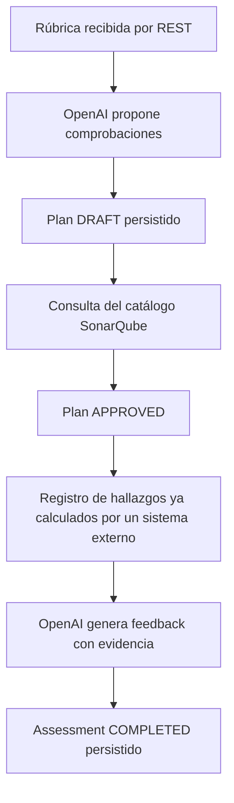

# Contexto maestro de PR-Gate Backend

Fecha de consolidación: 8 de noviembre de 2026.

Este documento reúne el contexto de los 14 archivos Markdown encontrados en el
repositorio, incluidos los requisitos de `.kiro`. Sirve como punto de entrada
para continuar el desarrollo. Es el único documento Markdown vigente del repositorio;
no convierte propuestas ni requisitos en funcionalidades terminadas.

La consolidación también incorpora las decisiones explícitas del equipo en
esta sesión y comprobaciones puntuales del código y de `compose.yml`. No se
consultaron bases de datos, archivos `.env` ni cuentas externas para redactarla.

## 1. Objetivo y alcance del sistema

PR-Gate es el backend de una tesis sobre evaluación y refuerzo del aprendizaje
de estudiantes mediante rúbricas, análisis de código y asistencia con un LLM.
El objetivo funcional completo es:

1. El docente define una rúbrica.
2. IA transforma sus criterios en propuestas de comprobación técnica.
3. El backend verifica qué criterios pueden comprobarse con SonarQube.
4. Un analizador revisa la entrega de código del estudiante.
5. IA convierte los hallazgos en explicaciones pedagógicas trazables.
6. IA genera un cuestionario o ejercicio de refuerzo.
7. El sistema registra respuestas y permite medir el aprendizaje.

El objetivo completo aún no está implementado. La generación de planes,
el registro de hallazgos y el feedback tienen casos de uso y endpoints; el
escaneo automático, la generación de cuestionarios por API y el seguimiento
del aprendizaje siguen pendientes.

En esta documentación, **test educativo** significa cuestionario o ejercicio
para el estudiante. **Prueba automatizada** significa una prueba de software,
por ejemplo JUnit; no son la misma funcionalidad.

## 2. Servicios y responsabilidades

| Servicio | Responsabilidad | Estado |
| --- | --- | --- |
| `users-service` | Perfiles, vínculo con Cognito, roles y estado del usuario | Implementación de perfiles y contrato interno; autenticación Cognito pendiente |
| `ai-service` | Planes técnicos, validación contra catálogo, análisis registrados y feedback con OpenAI | Dominio, aplicación, adaptadores, persistencia, REST, Swagger y Docker implementados |
| `metrics-service` | Administración de rúbricas y sus criterios | Estructura inicial; el dominio y la API de rúbricas aún no están implementados |

Puertos locales por defecto: usuarios `8080`, IA `8081` y métricas `8082`.

**Decisión del equipo:** `metrics-service` será el servicio de rúbricas. Esta
decisión corrige la ambigüedad de su README, que todavía propone acordar si
gestionará métricas técnicas o de aprendizaje. Criterios, niveles de logro,
ponderaciones y versionado forman parte del alcance a modelar, no de una API
que ya exista.

IA utilizará una referencia y una versión de la rúbrica, junto con los datos
utilizados en cada plan. No será la fuente oficial del catálogo de rúbricas.
La integración entre métricas e IA todavía necesita un contrato.

Las referencias al servicio de **Proyectos** en el README de usuarios describen
un consumidor esperado de su API interna. No se encontró un `projects-service`
en este repositorio y no se considera implementado aquí.

SonarQube es un sistema externo. No se confunde con IA ni con el servicio de
rúbricas, y el Compose actual no lo inicia.

## 3. Arquitectura y convenciones

La base tecnológica es Java 21 y Spring Boot 3.4.4, con Maven. IA y métricas
usan los paquetes `com.prgate.ai` y `com.prgate.metrics`.

La estructura hexagonal acordada para estos servicios es:

```text
domain/
  model/{aggregates,entities,valueobjects,enums}/
  policy/
  repository/
  exception/
application/
  dto/
  port/{in,out}/
  service/
infrastructure/
  inbound/rest/
  outbound/
bootstrap/
```

Las carpetas concretas pueden variar según lo implementado. `package-info.java`
conserva paquetes de la estructura; su presencia no implica que haya un caso
de uso terminado.

- El dominio expresa invariantes y no depende de Spring, ORM, Jackson ni SDKs.
- Aplicación coordina agregados y define puertos con tipos propios.
- Infraestructura implementa HTTP, persistencia y conexiones externas.
- `bootstrap` construye y conecta las dependencias con Spring.
- Los objetos del proveedor no deben atravesar la frontera del adaptador.
- Los servicios se integrarán por contratos, sin compartir entidades ni acceder
  directamente a las tablas de otros servicios.

**IA tiene un único contexto.** Rúbricas utilizadas como snapshots, análisis y
refuerzo son conceptos internos. No se mantienen bounded contexts separados
llamados `rubric`, `assessment` o `learning` dentro de IA. Tener varios agregados
no exige crear varios microservicios.

Fuentes principales: `ai-service/docs/architecture.md`,
`ai-service/docs/domain.md` y `metrics-service/README.md`.

## 4. Contexto de usuarios

### 4.1 Funcionalidad documentada

`users-service` administra perfiles locales con un UUID propio y un
`cognitoSub` que vincula el perfil con la identidad externa.

- Roles: `STUDENT`, `TEACHER` y `ADMIN`.
- Estados: `ACTIVE` e `INACTIVE`.
- Persistencia actual: Spring Data JPA y PostgreSQL.
- Pruebas de contrato: H2 con perfil de pruebas.
- Desarrollo: Hibernate usa `ddl-auto=update` según el README.
- Producción: el README propone migraciones y `ddl-auto=validate`; es una
  preparación pendiente, no una garantía de configuración productiva.

### 4.2 Contrato interno para Proyectos

```http
GET /internal/v1/users/{userId}
Authorization: Bearer <INTERNAL_SERVICE_TOKEN>
```

La respuesta contiene `id`, `firstName`, `lastName`, `role` y `status`.
Un usuario inactivo sigue devolviendo `200`; el consumidor debe comprobar
`status`. Un `5xx` no equivale a usuario inexistente.

| HTTP | Significado del contrato interno |
| --- | --- |
| 200 | Usuario existente; comprobar rol y estado |
| 400 | UUID inválido |
| 401 | Credencial ausente o esquema incorrecto |
| 403 | Credencial interna incorrecta |
| 404 | Usuario inexistente |
| 5xx | Fallo del servicio |

El token interno se configura en el entorno. El valor por defecto de desarrollo
documentado para usuarios no debe tratarse como credencial de producción.

### 4.3 Cognito: requisitos pendientes

`CLAUDE.md` marca `cognito-jwt-auth` como especificación activa. Esto no acredita
que esté implementada. El README la lista como pendiente y el controlador
revisado todavía recibe `cognitoSub` desde el cuerpo de registro.

La especificación exige:

1. Validar firma mediante JWKS, issuer y expiración del access token de Cognito.
2. Obtener `sub` del token y no confiar en la identidad enviada en el cuerpo.
3. Crear un UUID local; responder con el perfil y sin emitir un token nuevo.
4. Rechazar perfiles duplicados para el mismo `sub`.
5. Validar `firstName`, `lastName` y `contactEmail`; responder `400` ante cuerpos
   inválidos o datos obligatorios ausentes.
6. Responder `401` ante token ausente, inválido, expirado o de issuer incorrecto;
   no crear perfiles si el JWKS no puede verificarse.
7. Configurar issuer/JWKS por entorno, fallar ante configuración requerida
   ausente y mantener cualquier excepción local separada de producción.
8. Documentar en Swagger un esquema Cognito distinto del token entre servicios.
9. Probar JWT válido, ausente, inválido, expirado, issuer incorrecto y la
   imposibilidad de sustituir `sub` desde el cuerpo.
10. No persistir JWT, refresh tokens ni cabeceras de autorización; conservar solo
    el perfil y `cognitoSub`. El cliente renueva sus tokens mediante Cognito.
11. Exigir TLS al exponer las rutas fuera del entorno local.

También siguen pendientes, según el README, la autorización administrativa para
cambios de rol/estado y la publicación de eventos.

`users-service/docs/architecture.md` y `events.md` contienen solo encabezados.
No definen todavía un contrato detallado de eventos, transporte o consumidores.

Fuentes: `users-service/README.md`,
`.kiro/specs/cognito-jwt-auth/requirements.md` y
`CLAUDE.md`.

## 5. Contexto del dominio de IA

### 5.1 Agregados

| Agregado | Responsabilidad e invariantes |
| --- | --- |
| `TechnicalAssessmentPlan` | Rúbrica versionada, lenguaje y comprobaciones. Todo criterio tiene cobertura propuesta o revisión manual explícita. Aprobación desde `DRAFT` a `APPROVED` contra un catálogo |
| `Assessment` | Vincula plan aprobado, estudiante y revisión exacta de entrega; valida hallazgos y feedback |
| `LearningTest` | Modelo de cuestionario inicial o de refuerzo, con publicación desde `DRAFT` a `PUBLISHED`; todavía sin flujo generador por API |

Un plan aprobado conserva la versión de catálogo y no ofrece edición de sus
criterios. Un cambio requiere generar otro plan.

El ciclo del análisis es `PENDING → ANALYZING → ANALYZED → COMPLETED`.
Un fallo conserva etapa y motivo en `FAILED`. El dominio puede restaurar
`PENDING` tras fallo del análisis o `ANALYZED` tras fallo del feedback; la API
actual de reintento implementa específicamente el segundo caso.

No existen actualmente en ese enum los estados propuestos
`GENERATING_FEEDBACK` y `GENERATING_TEST` que aparecen en el diseño inicial.

### 5.2 Objetos de valor y trazabilidad

IDs tipados: `PlanId`, `AssessmentId`, `LearningTestId`, `CriterionId`,
`FindingId` y `QuestionId`.

Snapshots y referencias: `RubricReference`, `SourceLanguage`,
`SubmissionReference`, `RubricCriterion`, `TechnicalCheck`,
`TechnicalFinding`, `FeedbackItem` y `LearningQuestion`.

- Las colecciones son copiadas e inmutables desde el exterior.
- Los hallazgos deben corresponder a criterios y reglas configurados en el plan.
- El feedback cita evidencias existentes y del mismo criterio.
- Un análisis fallido no representa ausencia de problemas.
- El modelo de refuerzo exige evaluación completada y evidencia real.
- Las preguntas contienen solución y pauta internas; una futura API del
  estudiante debe excluirlas.
- No se duplican los agregados de estudiante y entrega dentro de IA.

Faltan intentos, respuestas, puntuación y seguimiento longitudinal. Tampoco hay
feedback basado en métricas como alternativa a hallazgos localizados.

## 6. Aplicación, adaptadores e integración del LLM

### 6.1 Casos de uso actuales

| Caso de uso | Comportamiento |
| --- | --- |
| `TranslateRubricService` | Solicita comprobaciones al LLM, construye y guarda un plan `DRAFT` válido |
| `GetTechnicalPlanService` | Devuelve una proyección inmutable del plan |
| `ApproveTechnicalPlanService` | Carga el catálogo para el lenguaje almacenado, valida y guarda `APPROVED` |
| `AssessmentService` | Registra resultados ya calculados, los consulta y coordina el reintento del feedback |
| `GenerateFeedbackService` | Exige `ANALYZED`, genera feedback, valida evidencia y persiste resultado o fallo |

`ApplicationConfiguration` conecta estos casos de uso con Spring. Los
repositorios de dominio tienen implementaciones JDBC y los proveedores se
acceden mediante puertos.

Puertos relevantes: `RubricTranslationPort`, `AnalysisCatalogPort` y
`FeedbackGenerator`. Algunos nombres de puertos del diseño inicial representan
trabajo futuro y no deben asumirse implementados.

### 6.2 OpenAI actual

La implementación utiliza **HTTP con `RestClient`**, no el SDK oficial Java
propuesto inicialmente. Los adaptadores de producción llaman a Responses API:

| Adaptador | Entrada/salida | Esquema | Límite de salida |
| --- | --- | --- | --- |
| `OpenAiRubricAdapter` | `RubricTranslationRequest` → `RubricTranslationResult` | `rubric_checks_v1` | 5000 tokens |
| `OpenAiFeedbackAdapter` | `FeedbackRequest` → `FeedbackResult` | `assessment_feedback` | 4000 tokens |

Ambos usan el modelo configurado, `store=false` y JSON Schema estricto mediante
`text.format`. La conexión tiene un límite de 10 segundos y la lectura de
60 segundos. No hay reintentos automáticos.

Las instrucciones se encuentran en los adaptadores actuales: deben tratar el
contenido recibido como datos, conservar UUID y no inventar evidencia. El JSON
estructurado no sustituye la validación semántica del dominio.

Procesamiento de respuesta:

1. Exigir estado `completed`.
2. Detectar rechazo del modelo.
3. Obtener los bloques `output_text`.
4. Deserializar y convertir identificadores a tipos propios.
5. Validar estructura y relaciones de evidencia.
6. Devolver el resultado al caso de uso, que decide cómo persistirlo.

`FeedbackRequest` incluye criterios y hallazgos, sin enviar el agregado completo.
`FeedbackResult` contiene resumen no vacío y elementos de feedback.

### 6.3 Límite real de SonarQube

`SonarCatalogAdapter` consulta `/api/rules/search` de forma paginada para
construir un snapshot de reglas del lenguaje.

La aprobación actual admite `SONAR_RULE` sin parámetros personalizados y
`MANUAL_REVIEW`. No implementa validación de métricas ni analizadores externos.
La presencia de `SONAR_METRIC` y `EXTERNAL_CHECK` en el enum no implica soporte
operativo completo.

Aprobar un plan no crea un quality profile, no ejecuta un scanner y no demuestra
que el código del alumno haya sido analizado. Importar hallazgos externos tampoco
convierte una descripción textual de la IA en una regla ejecutable.

Fuentes: `ai-service/docs/application.md`,
`IMPLEMENT-AI.md`, `ai-service/docs/openai-feedback.md`
y `ai-service/docs/api.md`.

## 7. Flujo que puede ejecutarse actualmente



La obtención oficial de la rúbrica desde `metrics-service` y la ejecución
automática del análisis todavía no están conectadas. Se puede probar la generación
de un `DRAFT` sin SonarQube; la aprobación requiere acceso al catálogo.

### 7.1 API de IA

Base local: `http://localhost:8081`.

| Método | Ruta | Resultado |
| --- | --- | --- |
| POST | `/api/technical-plans` | Genera y guarda un plan; `201` y `Location` |
| GET | `/api/technical-plans/{id}` | Recupera el plan |
| POST | `/api/technical-plans/{id}/approval` | Verifica y aprueba contra catálogo |
| POST | `/api/assessments` | Registra análisis ya calculado; `201` y `Location` |
| GET | `/api/assessments/{id}` | Recupera análisis y estado |
| POST | `/api/assessments/{id}/feedback` | Genera y guarda feedback |
| POST | `/api/assessments/{id}/feedback/retry` | Reintenta feedback fallido conservando el análisis |

La entrada de hallazgos es un contrato interno confiable. El servicio que llama
debe comprobar su procedencia, la revisión y la propiedad de la entrega.

### 7.2 Prueba inicial desde Swagger

1. Abrir [Swagger de IA](http://localhost:8081/swagger-ui/index.html).
2. Pulsar **Authorize** y pegar solamente el valor de `INTERNAL_SERVICE_TOKEN`.
3. Ejecutar `POST /api/technical-plans` con una rúbrica de prueba.
4. Esperar `201`, guardar el `id` y comprobar `status=DRAFT` y `checks`.
5. Consultar `GET /api/technical-plans/{id}` para confirmar persistencia.
6. Continuar con aprobación solo cuando SonarQube esté disponible.
7. Registrar hallazgos reales vinculados al plan y generar feedback.

Ejemplo de entrada; los UUID son ilustrativos:

```json
{
  "rubricId": "rubrica-prueba",
  "rubricVersion": 1,
  "language": "java",
  "criteria": [
    {
      "id": "11111111-1111-4111-8111-111111111111",
      "description": "Evitar variables locales que nunca se utilizan.",
      "objective": "Identificar código innecesario."
    }
  ]
}
```

Las llamadas reales consumen el saldo de la API. Los ejemplos completos de
registro y feedback están en [requests.http](ai-service/requests.http).

## 8. Persistencia y configuración

### 8.1 Diferencias entre servicios

Usuarios usa JPA/PostgreSQL. IA usa JDBC, snapshots JSON y Flyway, con H2 en
disco por defecto y PostgreSQL configurable. Métricas aún no tiene persistencia.

En IA, la migración `V1__create_ai_documents.sql` crea:

| Columna | Función |
| --- | --- |
| `kind` | Tipo de agregado, como `technical-plan` o `assessment` |
| `id` | UUID del agregado |
| `version` | Control de concurrencia de la fila |
| `payload` | Snapshot JSON |

La clave primaria es `(kind, id)`. Flyway mantiene además su historial de
migraciones. No se necesita una tabla para invocar OpenAI; se necesita
persistencia para conservar resultados y estados del backend.

Los repositorios recuperan agregados independientes y rechazan escrituras
obsoletas. Las llamadas remotas no mantienen abierta una transacción de BD.
Crear planes y registrar análisis todavía no tiene clave de idempotencia.

### 8.2 Variables

| Variable | Destino |
| --- | --- |
| `OPENAI_API_KEY` | Clave secreta del proyecto OpenAI |
| `OPENAI_MODEL` | Identificador de modelo compatible con Responses y Structured Outputs |
| `OPENAI_BASE_URL` | URL opcional; normalmente `https://api.openai.com/v1` |
| `INTERNAL_SERVICE_TOKEN` | Autenticación entre servicios |
| `SONAR_HOST_URL` / `SONAR_TOKEN` | Catálogo SonarQube |
| `SPRING_DATASOURCE_URL` | Conexión de base de datos |
| `SPRING_DATASOURCE_USERNAME` / `SPRING_DATASOURCE_PASSWORD` | Credenciales de BD |
| `SERVER_PORT` | Puerto del proceso |
| `AI_SERVICE_PORT` | Puerto publicado por Compose para IA |

El token interno no es la clave OpenAI, un identificador de proyecto ni un JWT
de Cognito. El identificador del modelo tampoco es el nombre o ID de una clave.

Las variables de cada servicio se configuran por separado. Este documento no
contiene valores reales de credenciales.

Para IA en Docker con PostgreSQL instalado en el equipo anfitrión:

```dotenv
SPRING_DATASOURCE_URL=jdbc:postgresql://host.docker.internal:5432/prgate_ai
SPRING_DATASOURCE_USERNAME=REEMPLAZAR_USUARIO
SPRING_DATASOURCE_PASSWORD=REEMPLAZAR_PASSWORD
```

La base debe existir y el usuario debe tener permisos para las migraciones.
Su creación y administración corresponden al propietario de la base. Si el
proceso Java corre directamente en la PC, se utiliza `localhost`; en despliegue
se utiliza el host real de la base.

H2 local, el volumen H2 de Docker y PostgreSQL son almacenamientos distintos.
Cambiar la URL no traslada registros anteriores. La persistencia productiva
requiere también respaldos y comprobación de restauración.

## 9. Arranque y operación

Todos los comandos Compose siguientes se ejecutan desde la raíz del backend:

```powershell
# Levantar usuarios e IA
docker compose up --build -d users-service ai-service

# Ver estado y logs de IA
docker compose ps users-service ai-service
docker compose logs --tail 100 ai-service

# Recargar variables modificadas en ai-service/.env
docker compose up -d --no-deps --force-recreate ai-service

# Incorporar cambios de código de IA
docker compose up --build -d --no-deps ai-service

# Detener solo IA conservando su volumen
docker compose stop ai-service
```

IA tiene el perfil opcional `ai`; seleccionarla por nombre permite iniciarla
junto a usuarios. No se ha agregado métricas al Compose.

Su Dockerfile construye con Maven/Java 21 y ejecuta con un JRE 21 y usuario
sin privilegios. El contexto excluye `.env` y datos locales. El volumen
`ai-service-data` se monta en `/app/data`.

Desde Docker Desktop, `localhost` es el contenedor. Para SonarQube o PostgreSQL
en la PC se utiliza `host.docker.internal`; para otro contenedor de la misma
red se utiliza su nombre de servicio.

Para ejecutar IA fuera de Docker, desde su carpeta:

```powershell
.\run-local.ps1
```

El script carga las variables permitidas de `.env` y respeta las ya existentes
en el proceso. Spring Boot por sí solo no carga ese archivo. Para métricas,
la estructura permite `mvn spring-boot:run` desde `metrics-service`, pero aún
no expone funcionalidad de rúbricas.

Swagger de usuarios: `http://localhost:8080/swagger-ui.html`.
Swagger de IA: `http://localhost:8081/swagger-ui/index.html`.
OpenAPI de IA: `http://localhost:8081/v3/api-docs`.

## 10. Seguridad e integración con el frontend

Las rutas `/api/**` de IA exigen un bearer interno. Swagger y la descripción
OpenAPI son accesibles sin ese token; ejecutar operaciones sí lo requiere.
No se comprueba todavía la identidad Cognito individual del alumno en IA.

El frontend no debe contener `INTERNAL_SERVICE_TOKEN` ni `OPENAI_API_KEY`.
Debe existir una frontera de autenticación/autorización por usuario que llame
a los endpoints internos de IA. Un token de servicio no acredita que un usuario
pueda acceder a una entrega específica.

No afirmar que el despliegue público está listo mientras Cognito, autorización
por recurso, integración de frontend y HTTPS sigan pendientes.

## 11. Errores y diagnóstico

| HTTP del backend | Interpretación |
| --- | --- |
| 400 | Campos, JSON o UUID inválidos |
| 401 | Falta o es incorrecto el token interno de IA |
| 404 | Plan o evaluación inexistente |
| 409 | Escritura concurrente obsoleta |
| 422 | Regla del dominio o transición inválida |
| 502 | Fallo de generación; revisar categoría cuando exista |
| 503 | Catálogo o persistencia no disponibles |

La traducción de rúbricas devuelve categorías seguras:

| `code` | Acción |
| --- | --- |
| `OPENAI_CREDITS_EXHAUSTED` | Revisar saldo de la organización de la clave |
| `OPENAI_USAGE_LIMIT` | Revisar límites de gasto/uso |
| `OPENAI_RATE_LIMITED` | Respetar el límite temporal de solicitudes |
| `OPENAI_AUTHENTICATION_FAILED` | Revisar la clave configurada |
| `OPENAI_PERMISSION_DENIED` | Revisar permisos del proyecto o clave |
| `OPENAI_MODEL_UNAVAILABLE` | Revisar el identificador y acceso al modelo |
| `OPENAI_REQUEST_REJECTED` | Revisar los parámetros de generación |
| `OPENAI_CONNECTION_FAILED` | Revisar conexión y timeout |
| `OPENAI_RESPONSE_INCOMPLETE` | Revisar por qué no terminó la generación |
| `OPENAI_RESPONSE_REFUSED` | La solicitud fue rechazada por el modelo |
| `OPENAI_RESPONSE_INVALID` | Resultado incompatible con el formato esperado |
| `AI_GENERATION_FAILED` | Fallo general sin categoría específica |

Si existe, `upstreamStatus` indica el HTTP del proveedor, diferente del HTTP
externo del backend. Por ejemplo, un `502` con
`OPENAI_CREDITS_EXHAUSTED` y `upstreamStatus=429` no se corrige creando tablas.
La mejora de categorías se implementó para traducción; el feedback todavía
utiliza su excepción y respuesta genéricas.

En el diagnóstico anterior se observaron primero un modelo mal configurado
y después créditos agotados. Son antecedentes de la sesión, no una consulta
actual del saldo ni una prueba de que hoy la cuenta siga en el mismo estado.

No se deben mostrar cuerpos originales del proveedor, claves ni cabeceras de
autorización al diagnosticar.

## 12. Pruebas y archivos generados

Familias documentadas o presentes en el código:

- Dominio: aprobación, cobertura, evidencia, transiciones y colecciones inmutables.
- Aplicación: traducción, consulta, aprobación y generación de feedback.
- Adaptadores: formato estructurado, HTTP, rechazos y validación de referencias.
- Integración de IA: Spring/REST, Flyway/H2, persistencia, reintento y concurrencia.
- Diagnóstico: categorías de error del proveedor y ausencia de filtración de mensajes.
- Usuarios: contrato interno, UUID, estado y autenticación entre servicios.

Desde la carpeta del servicio correspondiente:

```powershell
mvn test
```

Las pruebas automatizadas utilizan dobles o servidores HTTP locales para
servicios externos; los adaptadores de producción usan los proveedores reales.
Pasar esas pruebas no verifica saldo, credenciales o disponibilidad de OpenAI,
ni demuestra por sí solo mejora del aprendizaje.

Los números de pruebas en los documentos son históricos: por ejemplo, la API
documenta 31 y la corrección de diagnósticos añadió una ejecución focalizada
de 14. Este documento no afirma haber ejecutado toda la suite conjuntamente.

`target/` contiene clases, reportes y listas generadas. Está excluido de Git y
no es la fuente de configuración. Editar `src/main/resources/application.yml`,
no `target/classes/application.yml`. La limpieza de `target` no eliminó `src/test`.
Construir la imagen con `-DskipTests` no equivale a ejecutar las pruebas.

## 13. Diferencias resueltas entre documentos

| Fuente o afirmación | Contexto consolidado |
| --- | --- |
| `IMPLEMENT-AI.md` y `openai-feedback.md` dicen que faltan endpoint, servicio y persistencia de feedback | Describen una etapa anterior. Esos componentes ya existen |
| `architecture.md` propone el SDK oficial de OpenAI | La implementación actual usa HTTP/`RestClient` |
| `application.md` contiene frases de “sin beans/endpoints” | Su aviso inicial y el código actual acreditan wiring y REST implementados |
| El diseño propone estados de generación adicionales | El enum actual usa `PENDING`, `ANALYZING`, `ANALYZED`, `COMPLETED` y `FAILED` |
| El README de métricas deja abierto su objetivo | El equipo decidió que administrará rúbricas; falta implementar ese dominio |
| La especificación Cognito habla de persistencia en memoria | Usuarios actualmente usa JPA/PostgreSQL |
| Cognito aparece como especificación activa | Es una tarea definida, no autenticación ya terminada |
| Documentación antigua dice que Compose inicia solo usuarios | Actualmente permite usuarios e IA; métricas sigue fuera |
| `users-service/docs/events.md` y `architecture.md` parecen documentos temáticos | Solo tienen encabezados; no aportan contratos detallados |
| Un agregado `LearningTest` existe en dominio | La generación y publicación mediante API todavía no están conectadas |

Los documentos originales se retiraron después de consolidarlos. Sus rutas se conservan como referencias históricas. Los cambios posteriores de contexto deben registrarse en este documento maestro.

## 14. Trabajo pendiente y orden de continuación

1. Confirmar en el entorno del equipo una generación real `201` y recuperación
   `200` del plan, con saldo y configuración válidos.
2. Implementar rúbricas en `metrics-service`: modelo, versionado, persistencia,
   reglas de edición y endpoints; acordar contrato con IA.
3. Completar la autenticación Cognito y la autorización por rol/recurso.
4. Integrar análisis real de una revisión de código, su correlación y la
   configuración efectiva de perfiles en SonarQube.
5. Implementar generación de test inicial/refuerzo y DTOs del estudiante.
6. Modelar respuestas, corrección, intentos y progreso; definir evaluación
   de calidad y aprendizaje con docentes.
7. Resolver asincronía e idempotencia donde corresponda, además de publicación
   de eventos y semántica de entrega si existen consumidores.
8. Conectar el frontend con una frontera segura de acceso a servicios internos.
9. Preparar despliegue, secretos, PostgreSQL, respaldos, HTTPS y verificación
   del flujo tras reinicios.

No se definieron aquí proveedores de nube, un broker ni nuevas dependencias.
Esas son decisiones posteriores a acordar según el despliegue real.

## 15. Inventario histórico de las 14 fuentes consolidadas

Estos archivos ya no están en el repositorio. Se registran para conservar la procedencia del contexto; no son enlaces de navegación ni documentación vigente.

| Archivo | Contexto aportado |
| --- | --- |
| `README.md` | Identidad del repositorio; solo contiene el título |
| `CLAUDE.md` | Especificación Cognito activa |
| `IMPLEMENT-AI.md` | Detalle histórico de la implementación de feedback, DTOs, esquema y errores |
| `users-service/README.md` | Perfiles, persistencia, contrato interno, configuración y pendientes |
| `users-service/docs/architecture.md` | Encabezado de arquitectura pendiente de desarrollar |
| `users-service/docs/events.md` | Encabezado de eventos pendiente de desarrollar |
| `.kiro/specs/cognito-jwt-auth/requirements.md` | Requisitos y aceptación de autenticación Cognito |
| `ai-service/README.md` | Estado operativo, Docker, Swagger y diagnóstico actualizado |
| `ai-service/docs/architecture.md` | Diseño hexagonal/DDD, alcance y propuestas históricas |
| `ai-service/docs/domain.md` | Agregados, objetos de valor e invariantes |
| `ai-service/docs/application.md` | Casos de uso, puertos y límites de aplicación |
| `ai-service/docs/api.md` | Endpoints, persistencia, configuración y límites operativos |
| `ai-service/docs/openai-feedback.md` | Contrato del adaptador de feedback y condiciones de respuesta |
| `metrics-service/README.md` | Estructura del servicio independiente y estado inicial |

Comprobaciones adicionales, sin ejecutar servicios: `compose.yml`, POM de
usuarios, controlador de usuarios, `ApplicationConfiguration` y
`OpenApiConfiguration` de IA. Para preparar la guía anterior de IA también se
leyeron sus controladores, adaptadores, repositorios y migración SQL.

Este archivo es documentación: no cambia código, credenciales, datos ni
configuración de ejecución. No implica commit, push o despliegue.
