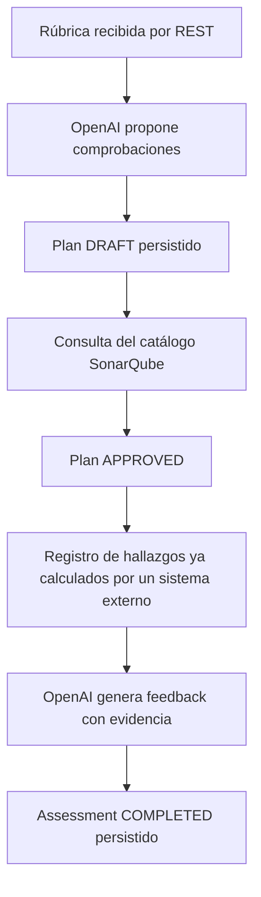

# Contexto maestro de PR-Gate Backend

Fecha de consolidación: 8 de noviembre de 2026.

Este documento reúne el contexto de los 14 archivos Markdown encontrados en el
repositorio, incluidos los requisitos de `.kiro`. Sirve como punto de entrada
para continuar el desarrollo. Es el único documento Markdown vigente del repositorio;
no convierte propuestas ni requisitos en funcionalidades terminadas.

La consolidación también incorpora las decisiones explícitas del equipo en
esta sesión y comprobaciones puntuales del código y de `compose.yml`. No se
consultaron bases de datos, archivos `.env` ni cuentas externas para redactarla.

## 1. Objetivo y alcance del sistema

PR-Gate es el backend de una tesis sobre evaluación y refuerzo del aprendizaje
de estudiantes mediante rúbricas, análisis de código y asistencia con un LLM.
El objetivo funcional completo es:

1. El docente define una rúbrica.
2. IA transforma sus criterios en propuestas de comprobación técnica.
3. El backend verifica qué criterios pueden comprobarse con SonarQube.
4. Un analizador revisa la entrega de código del estudiante.
5. IA convierte los hallazgos en explicaciones pedagógicas trazables.
6. IA genera un cuestionario o ejercicio de refuerzo.
7. El sistema registra respuestas y permite medir el aprendizaje.

El objetivo completo aún no está implementado. La generación de planes,
el registro de hallazgos y el feedback tienen casos de uso y endpoints; el
escaneo automático, la generación de cuestionarios por API y el seguimiento
del aprendizaje siguen pendientes.

En esta documentación, **test educativo** significa cuestionario o ejercicio
para el estudiante. **Prueba automatizada** significa una prueba de software,
por ejemplo JUnit; no son la misma funcionalidad.

## 2. Servicios y responsabilidades

| Servicio | Responsabilidad | Estado |
| --- | --- | --- |
| `users-service` | Perfiles, vínculo con Cognito, roles y estado del usuario | Implementación de perfiles y contrato interno; autenticación Cognito pendiente |
| `ai-service` | Planes técnicos, validación contra catálogo, análisis registrados y feedback con OpenAI | Dominio, aplicación, adaptadores, persistencia, REST, Swagger y Docker implementados |
| `metrics-service` | Rúbricas y evaluación determinista de cumplimiento con evidencias de SonarQube | Dominio DDD y políticas implementados; aplicación, persistencia, REST e integraciones pendientes |

Puertos locales por defecto: usuarios `8080`, IA `8081` y métricas `8082`.

**Decisión del equipo:** `metrics-service` será el servicio de rúbricas. Esta
decisión corrige la ambigüedad de su README, que todavía propone acordar si
gestionará métricas técnicas o de aprendizaje. El dominio actual incluye criterios, ponderaciones, versionado y evaluación binaria.
Los niveles de logro graduados y la API aún no están implementados.

IA utilizará una referencia y una versión de la rúbrica, junto con los datos
utilizados en cada plan. No será la fuente oficial del catálogo de rúbricas.
La integración entre métricas e IA todavía necesita un contrato.

Las referencias al servicio de **Proyectos** en el README de usuarios describen
un consumidor esperado de su API interna. No se encontró un `projects-service`
en este repositorio y no se considera implementado aquí.

SonarQube es un sistema externo. No se confunde con IA ni con el servicio de
rúbricas, y el Compose actual no lo inicia.

## 3. Arquitectura y convenciones

La base tecnológica es Java 21 y Spring Boot 3.4.4, con Maven. IA y métricas
usan los paquetes `com.prgate.ai` y `com.prgate.metrics`.

La estructura hexagonal acordada para estos servicios es:

```text
domain/
  model/{aggregates,entities,valueobjects,enums}/
  policy/
  repository/
  exception/
application/
  dto/
  port/{in,out}/
  service/
infrastructure/
  inbound/rest/
  outbound/
bootstrap/
```

Las carpetas concretas pueden variar según lo implementado. `package-info.java`
conserva paquetes de la estructura; su presencia no implica que haya un caso
de uso terminado.

- El dominio expresa invariantes y no depende de Spring, ORM, Jackson ni SDKs.
- Aplicación coordina agregados y define puertos con tipos propios.
- Infraestructura implementa HTTP, persistencia y conexiones externas.
- `bootstrap` construye y conecta las dependencias con Spring.
- Los objetos del proveedor no deben atravesar la frontera del adaptador.
- Los servicios se integrarán por contratos, sin compartir entidades ni acceder
  directamente a las tablas de otros servicios.

**IA tiene un único contexto.** Rúbricas utilizadas como snapshots, análisis y
refuerzo son conceptos internos. No se mantienen bounded contexts separados
llamados `rubric`, `assessment` o `learning` dentro de IA. Tener varios agregados
no exige crear varios microservicios.

Fuentes principales: `ai-service/docs/architecture.md`,
`ai-service/docs/domain.md` y `metrics-service/README.md`.

## 4. Contexto de usuarios

### 4.1 Funcionalidad documentada

`users-service` administra perfiles locales con un UUID propio y un
`cognitoSub` que vincula el perfil con la identidad externa.

- Roles: `STUDENT`, `TEACHER` y `ADMIN`.
- Estados: `ACTIVE` e `INACTIVE`.
- Persistencia actual: Spring Data JPA y PostgreSQL.
- Pruebas de contrato: H2 con perfil de pruebas.
- Desarrollo: Hibernate usa `ddl-auto=update` según el README.
- Producción: el README propone migraciones y `ddl-auto=validate`; es una
  preparación pendiente, no una garantía de configuración productiva.

### 4.2 Contrato interno para Proyectos

```http
GET /internal/v1/users/{userId}
Authorization: Bearer <INTERNAL_SERVICE_TOKEN>
```

La respuesta contiene `id`, `firstName`, `lastName`, `role` y `status`.
Un usuario inactivo sigue devolviendo `200`; el consumidor debe comprobar
`status`. Un `5xx` no equivale a usuario inexistente.

| HTTP | Significado del contrato interno |
| --- | --- |
| 200 | Usuario existente; comprobar rol y estado |
| 400 | UUID inválido |
| 401 | Credencial ausente o esquema incorrecto |
| 403 | Credencial interna incorrecta |
| 404 | Usuario inexistente |
| 5xx | Fallo del servicio |

El token interno se configura en el entorno. El valor por defecto de desarrollo
documentado para usuarios no debe tratarse como credencial de producción.

### 4.3 Cognito: requisitos pendientes

`CLAUDE.md` marca `cognito-jwt-auth` como especificación activa. Esto no acredita
que esté implementada. El README la lista como pendiente y el controlador
revisado todavía recibe `cognitoSub` desde el cuerpo de registro.

La especificación exige:

1. Validar firma mediante JWKS, issuer y expiración del access token de Cognito.
2. Obtener `sub` del token y no confiar en la identidad enviada en el cuerpo.
3. Crear un UUID local; responder con el perfil y sin emitir un token nuevo.
4. Rechazar perfiles duplicados para el mismo `sub`.
5. Validar `firstName`, `lastName` y `contactEmail`; responder `400` ante cuerpos
   inválidos o datos obligatorios ausentes.
6. Responder `401` ante token ausente, inválido, expirado o de issuer incorrecto;
   no crear perfiles si el JWKS no puede verificarse.
7. Configurar issuer/JWKS por entorno, fallar ante configuración requerida
   ausente y mantener cualquier excepción local separada de producción.
8. Documentar en Swagger un esquema Cognito distinto del token entre servicios.
9. Probar JWT válido, ausente, inválido, expirado, issuer incorrecto y la
   imposibilidad de sustituir `sub` desde el cuerpo.
10. No persistir JWT, refresh tokens ni cabeceras de autorización; conservar solo
    el perfil y `cognitoSub`. El cliente renueva sus tokens mediante Cognito.
11. Exigir TLS al exponer las rutas fuera del entorno local.

También siguen pendientes, según el README, la autorización administrativa para
cambios de rol/estado y la publicación de eventos.

`users-service/docs/architecture.md` y `events.md` contienen solo encabezados.
No definen todavía un contrato detallado de eventos, transporte o consumidores.

Fuentes: `users-service/README.md`,
`.kiro/specs/cognito-jwt-auth/requirements.md` y
`CLAUDE.md`.

## 5. Contexto del dominio de IA

### 5.1 Agregados

| Agregado | Responsabilidad e invariantes |
| --- | --- |
| `TechnicalAssessmentPlan` | Rúbrica versionada, lenguaje y comprobaciones. Todo criterio tiene cobertura propuesta o revisión manual explícita. Aprobación desde `DRAFT` a `APPROVED` contra un catálogo |
| `Assessment` | Vincula plan aprobado, estudiante y revisión exacta de entrega; valida hallazgos y feedback |
| `LearningTest` | Modelo de cuestionario inicial o de refuerzo, con publicación desde `DRAFT` a `PUBLISHED`; todavía sin flujo generador por API |

Un plan aprobado conserva la versión de catálogo y no ofrece edición de sus
criterios. Un cambio requiere generar otro plan.

El ciclo del análisis es `PENDING → ANALYZING → ANALYZED → COMPLETED`.
Un fallo conserva etapa y motivo en `FAILED`. El dominio puede restaurar
`PENDING` tras fallo del análisis o `ANALYZED` tras fallo del feedback; la API
actual de reintento implementa específicamente el segundo caso.

No existen actualmente en ese enum los estados propuestos
`GENERATING_FEEDBACK` y `GENERATING_TEST` que aparecen en el diseño inicial.

### 5.2 Objetos de valor y trazabilidad

IDs tipados: `PlanId`, `AssessmentId`, `LearningTestId`, `CriterionId`,
`FindingId` y `QuestionId`.

Snapshots y referencias: `RubricReference`, `SourceLanguage`,
`SubmissionReference`, `RubricCriterion`, `TechnicalCheck`,
`TechnicalFinding`, `FeedbackItem` y `LearningQuestion`.

- Las colecciones son copiadas e inmutables desde el exterior.
- Los hallazgos deben corresponder a criterios y reglas configurados en el plan.
- El feedback cita evidencias existentes y del mismo criterio.
- Un análisis fallido no representa ausencia de problemas.
- El modelo de refuerzo exige evaluación completada y evidencia real.
- Las preguntas contienen solución y pauta internas; una futura API del
  estudiante debe excluirlas.
- No se duplican los agregados de estudiante y entrega dentro de IA.

Faltan intentos, respuestas, puntuación y seguimiento longitudinal. Tampoco hay
feedback basado en métricas como alternativa a hallazgos localizados.

## 6. Aplicación, adaptadores e integración del LLM

### 6.1 Casos de uso actuales

| Caso de uso | Comportamiento |
| --- | --- |
| `TranslateRubricService` | Solicita comprobaciones al LLM, construye y guarda un plan `DRAFT` válido |
| `GetTechnicalPlanService` | Devuelve una proyección inmutable del plan |
| `ApproveTechnicalPlanService` | Carga el catálogo para el lenguaje almacenado, valida y guarda `APPROVED` |
| `AssessmentService` | Registra resultados ya calculados, los consulta y coordina el reintento del feedback |
| `GenerateFeedbackService` | Exige `ANALYZED`, genera feedback, valida evidencia y persiste resultado o fallo |

`ApplicationConfiguration` conecta estos casos de uso con Spring. Los
repositorios de dominio tienen implementaciones JDBC y los proveedores se
acceden mediante puertos.

Puertos relevantes: `RubricTranslationPort`, `AnalysisCatalogPort` y
`FeedbackGenerator`. Algunos nombres de puertos del diseño inicial representan
trabajo futuro y no deben asumirse implementados.

### 6.2 OpenAI actual

La implementación utiliza **HTTP con `RestClient`**, no el SDK oficial Java
propuesto inicialmente. Los adaptadores de producción llaman a Responses API:

| Adaptador | Entrada/salida | Esquema | Límite de salida |
| --- | --- | --- | --- |
| `OpenAiRubricAdapter` | `RubricTranslationRequest` → `RubricTranslationResult` | `rubric_checks_v1` | 5000 tokens |
| `OpenAiFeedbackAdapter` | `FeedbackRequest` → `FeedbackResult` | `assessment_feedback` | 4000 tokens |

Ambos usan el modelo configurado, `store=false` y JSON Schema estricto mediante
`text.format`. La conexión tiene un límite de 10 segundos y la lectura de
60 segundos. No hay reintentos automáticos.

Las instrucciones se encuentran en los adaptadores actuales: deben tratar el
contenido recibido como datos, conservar UUID y no inventar evidencia. El JSON
estructurado no sustituye la validación semántica del dominio.

Procesamiento de respuesta:

1. Exigir estado `completed`.
2. Detectar rechazo del modelo.
3. Obtener los bloques `output_text`.
4. Deserializar y convertir identificadores a tipos propios.
5. Validar estructura y relaciones de evidencia.
6. Devolver el resultado al caso de uso, que decide cómo persistirlo.

`FeedbackRequest` incluye criterios y hallazgos, sin enviar el agregado completo.
`FeedbackResult` contiene resumen no vacío y elementos de feedback.

### 6.3 Límite real de SonarQube

`SonarCatalogAdapter` consulta `/api/rules/search` de forma paginada para
construir un snapshot de reglas del lenguaje.

La aprobación actual admite `SONAR_RULE` sin parámetros personalizados y
`MANUAL_REVIEW`. No implementa validación de métricas ni analizadores externos.
La presencia de `SONAR_METRIC` y `EXTERNAL_CHECK` en el enum no implica soporte
operativo completo.

Aprobar un plan no crea un quality profile, no ejecuta un scanner y no demuestra
que el código del alumno haya sido analizado. Importar hallazgos externos tampoco
convierte una descripción textual de la IA en una regla ejecutable.

Fuentes: `ai-service/docs/application.md`,
`IMPLEMENT-AI.md`, `ai-service/docs/openai-feedback.md`
y `ai-service/docs/api.md`.

## 7. Flujo que puede ejecutarse actualmente



La obtención oficial de la rúbrica desde `metrics-service` y la ejecución
automática del análisis todavía no están conectadas. Se puede probar la generación
de un `DRAFT` sin SonarQube; la aprobación requiere acceso al catálogo.

### 7.1 API de IA

Base local: `http://localhost:8081`.

| Método | Ruta | Resultado |
| --- | --- | --- |
| POST | `/api/technical-plans` | Genera y guarda un plan; `201` y `Location` |
| GET | `/api/technical-plans/{id}` | Recupera el plan |
| POST | `/api/technical-plans/{id}/approval` | Verifica y aprueba contra catálogo |
| POST | `/api/assessments` | Registra análisis ya calculado; `201` y `Location` |
| GET | `/api/assessments/{id}` | Recupera análisis y estado |
| POST | `/api/assessments/{id}/feedback` | Genera y guarda feedback |
| POST | `/api/assessments/{id}/feedback/retry` | Reintenta feedback fallido conservando el análisis |

La entrada de hallazgos es un contrato interno confiable. El servicio que llama
debe comprobar su procedencia, la revisión y la propiedad de la entrega.

### 7.2 Prueba inicial desde Swagger

1. Abrir [Swagger de IA](http://localhost:8081/swagger-ui/index.html).
2. Pulsar **Authorize** y pegar solamente el valor de `INTERNAL_SERVICE_TOKEN`.
3. Ejecutar `POST /api/technical-plans` con una rúbrica de prueba.
4. Esperar `201`, guardar el `id` y comprobar `status=DRAFT` y `checks`.
5. Consultar `GET /api/technical-plans/{id}` para confirmar persistencia.
6. Continuar con aprobación solo cuando SonarQube esté disponible.
7. Registrar hallazgos reales vinculados al plan y generar feedback.

Ejemplo de entrada; los UUID son ilustrativos:

```json
{
  "rubricId": "rubrica-prueba",
  "rubricVersion": 1,
  "language": "java",
  "criteria": [
    {
      "id": "11111111-1111-4111-8111-111111111111",
      "description": "Evitar variables locales que nunca se utilizan.",
      "objective": "Identificar código innecesario."
    }
  ]
}
```

Las llamadas reales consumen el saldo de la API. Los ejemplos completos de
registro y feedback están en [requests.http](ai-service/requests.http).

## 8. Persistencia y configuración

### 8.1 Diferencias entre servicios

Usuarios usa JPA/PostgreSQL. IA usa JDBC, snapshots JSON y Flyway, con H2 en
disco por defecto y PostgreSQL configurable. Métricas aún no tiene persistencia.

En IA, la migración `V1__create_ai_documents.sql` crea:

| Columna | Función |
| --- | --- |
| `kind` | Tipo de agregado, como `technical-plan` o `assessment` |
| `id` | UUID del agregado |
| `version` | Control de concurrencia de la fila |
| `payload` | Snapshot JSON |

La clave primaria es `(kind, id)`. Flyway mantiene además su historial de
migraciones. No se necesita una tabla para invocar OpenAI; se necesita
persistencia para conservar resultados y estados del backend.

Los repositorios recuperan agregados independientes y rechazan escrituras
obsoletas. Las llamadas remotas no mantienen abierta una transacción de BD.
Crear planes y registrar análisis todavía no tiene clave de idempotencia.

### 8.2 Variables

| Variable | Destino |
| --- | --- |
| `OPENAI_API_KEY` | Clave secreta del proyecto OpenAI |
| `OPENAI_MODEL` | Identificador de modelo compatible con Responses y Structured Outputs |
| `OPENAI_BASE_URL` | URL opcional; normalmente `https://api.openai.com/v1` |
| `INTERNAL_SERVICE_TOKEN` | Autenticación entre servicios |
| `SONAR_HOST_URL` / `SONAR_TOKEN` | Catálogo SonarQube |
| `SPRING_DATASOURCE_URL` | Conexión de base de datos |
| `SPRING_DATASOURCE_USERNAME` / `SPRING_DATASOURCE_PASSWORD` | Credenciales de BD |
| `SERVER_PORT` | Puerto del proceso |
| `AI_SERVICE_PORT` | Puerto publicado por Compose para IA |

El token interno no es la clave OpenAI, un identificador de proyecto ni un JWT
de Cognito. El identificador del modelo tampoco es el nombre o ID de una clave.

Las variables de cada servicio se configuran por separado. Este documento no
contiene valores reales de credenciales.

Para IA en Docker con PostgreSQL instalado en el equipo anfitrión:

```dotenv
SPRING_DATASOURCE_URL=jdbc:postgresql://host.docker.internal:5432/prgate_ai
SPRING_DATASOURCE_USERNAME=REEMPLAZAR_USUARIO
SPRING_DATASOURCE_PASSWORD=REEMPLAZAR_PASSWORD
```

La base debe existir y el usuario debe tener permisos para las migraciones.
Su creación y administración corresponden al propietario de la base. Si el
proceso Java corre directamente en la PC, se utiliza `localhost`; en despliegue
se utiliza el host real de la base.

H2 local, el volumen H2 de Docker y PostgreSQL son almacenamientos distintos.
Cambiar la URL no traslada registros anteriores. La persistencia productiva
requiere también respaldos y comprobación de restauración.

## 9. Arranque y operación

Todos los comandos Compose siguientes se ejecutan desde la raíz del backend:

```powershell
# Levantar usuarios e IA
docker compose up --build -d users-service ai-service

# Ver estado y logs de IA
docker compose ps users-service ai-service
docker compose logs --tail 100 ai-service

# Recargar variables modificadas en ai-service/.env
docker compose up -d --no-deps --force-recreate ai-service

# Incorporar cambios de código de IA
docker compose up --build -d --no-deps ai-service

# Detener solo IA conservando su volumen
docker compose stop ai-service
```

IA tiene el perfil opcional `ai`; seleccionarla por nombre permite iniciarla
junto a usuarios. No se ha agregado métricas al Compose.

Su Dockerfile construye con Maven/Java 21 y ejecuta con un JRE 21 y usuario
sin privilegios. El contexto excluye `.env` y datos locales. El volumen
`ai-service-data` se monta en `/app/data`.

Desde Docker Desktop, `localhost` es el contenedor. Para SonarQube o PostgreSQL
en la PC se utiliza `host.docker.internal`; para otro contenedor de la misma
red se utiliza su nombre de servicio.

El arranque documentado de IA se realiza mediante Docker Compose desde la raíz.
Se eliminó el script de arranque local para mantener una sola guía de ejecución.
Para métricas, la estructura permite ejecutar Maven desde metrics-service,
pero aún no expone funcionalidad de rúbricas.

Swagger de usuarios: `http://localhost:8080/swagger-ui.html`.
Swagger de IA: `http://localhost:8081/swagger-ui/index.html`.
OpenAPI de IA: `http://localhost:8081/v3/api-docs`.

## 10. Seguridad e integración con el frontend

Las rutas `/api/**` de IA exigen un bearer interno. Swagger y la descripción
OpenAPI son accesibles sin ese token; ejecutar operaciones sí lo requiere.
No se comprueba todavía la identidad Cognito individual del alumno en IA.

El frontend no debe contener `INTERNAL_SERVICE_TOKEN` ni `OPENAI_API_KEY`.
Debe existir una frontera de autenticación/autorización por usuario que llame
a los endpoints internos de IA. Un token de servicio no acredita que un usuario
pueda acceder a una entrega específica.

No afirmar que el despliegue público está listo mientras Cognito, autorización
por recurso, integración de frontend y HTTPS sigan pendientes.

## 11. Errores y diagnóstico

| HTTP del backend | Interpretación |
| --- | --- |
| 400 | Campos, JSON o UUID inválidos |
| 401 | Falta o es incorrecto el token interno de IA |
| 404 | Plan o evaluación inexistente |
| 409 | Escritura concurrente obsoleta |
| 422 | Regla del dominio o transición inválida |
| 502 | Fallo de generación; revisar categoría cuando exista |
| 503 | Catálogo o persistencia no disponibles |

La traducción de rúbricas devuelve categorías seguras:

| `code` | Acción |
| --- | --- |
| `OPENAI_CREDITS_EXHAUSTED` | Revisar saldo de la organización de la clave |
| `OPENAI_USAGE_LIMIT` | Revisar límites de gasto/uso |
| `OPENAI_RATE_LIMITED` | Respetar el límite temporal de solicitudes |
| `OPENAI_AUTHENTICATION_FAILED` | Revisar la clave configurada |
| `OPENAI_PERMISSION_DENIED` | Revisar permisos del proyecto o clave |
| `OPENAI_MODEL_UNAVAILABLE` | Revisar el identificador y acceso al modelo |
| `OPENAI_REQUEST_REJECTED` | Revisar los parámetros de generación |
| `OPENAI_CONNECTION_FAILED` | Revisar conexión y timeout |
| `OPENAI_RESPONSE_INCOMPLETE` | Revisar por qué no terminó la generación |
| `OPENAI_RESPONSE_REFUSED` | La solicitud fue rechazada por el modelo |
| `OPENAI_RESPONSE_INVALID` | Resultado incompatible con el formato esperado |
| `AI_GENERATION_FAILED` | Fallo general sin categoría específica |

Si existe, `upstreamStatus` indica el HTTP del proveedor, diferente del HTTP
externo del backend. Por ejemplo, un `502` con
`OPENAI_CREDITS_EXHAUSTED` y `upstreamStatus=429` no se corrige creando tablas.
La mejora de categorías se implementó para traducción; el feedback todavía
utiliza su excepción y respuesta genéricas.

En el diagnóstico anterior se observaron primero un modelo mal configurado
y después créditos agotados. Son antecedentes de la sesión, no una consulta
actual del saldo ni una prueba de que hoy la cuenta siga en el mismo estado.

No se deben mostrar cuerpos originales del proveedor, claves ni cabeceras de
autorización al diagnosticar.

## 12. Pruebas y archivos generados

Familias documentadas o presentes en el código:

- Dominio: aprobación, cobertura, evidencia, transiciones y colecciones inmutables.
- Aplicación: traducción, consulta, aprobación y generación de feedback.
- Adaptadores: formato estructurado, HTTP, rechazos y validación de referencias.
- Integración de IA: Spring/REST, Flyway/H2, persistencia, reintento y concurrencia.
- Diagnóstico: categorías de error del proveedor y ausencia de filtración de mensajes.
- Usuarios: contrato interno, UUID, estado y autenticación entre servicios.

Desde la carpeta del servicio correspondiente:

```powershell
mvn test
```

Las pruebas automatizadas utilizan dobles o servidores HTTP locales para
servicios externos; los adaptadores de producción usan los proveedores reales.
Pasar esas pruebas no verifica saldo, credenciales o disponibilidad de OpenAI,
ni demuestra por sí solo mejora del aprendizaje.

Los números de pruebas en los documentos son históricos: por ejemplo, la API
documenta 31 y la corrección de diagnósticos añadió una ejecución focalizada
de 14. Este documento no afirma haber ejecutado toda la suite conjuntamente.

`target/` contiene clases, reportes y listas generadas. Está excluido de Git y
no es la fuente de configuración. Editar `src/main/resources/application.yml`,
no `target/classes/application.yml`. La limpieza de `target` no eliminó `src/test`.
Construir la imagen con `-DskipTests` no equivale a ejecutar las pruebas.

## 13. Diferencias resueltas entre documentos

| Fuente o afirmación | Contexto consolidado |
| --- | --- |
| `IMPLEMENT-AI.md` y `openai-feedback.md` dicen que faltan endpoint, servicio y persistencia de feedback | Describen una etapa anterior. Esos componentes ya existen |
| `architecture.md` propone el SDK oficial de OpenAI | La implementación actual usa HTTP/`RestClient` |
| `application.md` contiene frases de “sin beans/endpoints” | Su aviso inicial y el código actual acreditan wiring y REST implementados |
| El diseño propone estados de generación adicionales | El enum actual usa `PENDING`, `ANALYZING`, `ANALYZED`, `COMPLETED` y `FAILED` |
| El README de métricas deja abierto su objetivo | El equipo decidió que administrará rúbricas; falta implementar ese dominio |
| La especificación Cognito habla de persistencia en memoria | Usuarios actualmente usa JPA/PostgreSQL |
| Cognito aparece como especificación activa | Es una tarea definida, no autenticación ya terminada |
| Documentación antigua dice que Compose inicia solo usuarios | Actualmente permite usuarios e IA; métricas sigue fuera |
| `users-service/docs/events.md` y `architecture.md` parecen documentos temáticos | Solo tienen encabezados; no aportan contratos detallados |
| Un agregado `LearningTest` existe en dominio | La generación y publicación mediante API todavía no están conectadas |

Los documentos originales se retiraron después de consolidarlos. Sus rutas se conservan como referencias históricas. Los cambios posteriores de contexto deben registrarse en este documento maestro.

## 14. Trabajo pendiente y orden de continuación

1. Confirmar en el entorno del equipo una generación real `201` y recuperación
   `200` del plan, con saldo y configuración válidos.
2. Implementar rúbricas en `metrics-service`: modelo, versionado, persistencia,
   reglas de edición y endpoints; acordar contrato con IA.
3. Completar la autenticación Cognito y la autorización por rol/recurso.
4. Integrar análisis real de una revisión de código, su correlación y la
   configuración efectiva de perfiles en SonarQube.
5. Implementar generación de test inicial/refuerzo y DTOs del estudiante.
6. Modelar respuestas, corrección, intentos y progreso; definir evaluación
   de calidad y aprendizaje con docentes.
7. Resolver asincronía e idempotencia donde corresponda, además de publicación
   de eventos y semántica de entrega si existen consumidores.
8. Conectar el frontend con una frontera segura de acceso a servicios internos.
9. Preparar despliegue, secretos, PostgreSQL, respaldos, HTTPS y verificación
   del flujo tras reinicios.

No se definieron aquí proveedores de nube, un broker ni nuevas dependencias.
Esas son decisiones posteriores a acordar según el despliegue real.

## 15. Inventario histórico de las 14 fuentes consolidadas

Estos archivos ya no están en el repositorio. Se registran para conservar la procedencia del contexto; no son enlaces de navegación ni documentación vigente.

| Archivo | Contexto aportado |
| --- | --- |
| `README.md` | Identidad del repositorio; solo contiene el título |
| `CLAUDE.md` | Especificación Cognito activa |
| `IMPLEMENT-AI.md` | Detalle histórico de la implementación de feedback, DTOs, esquema y errores |
| `users-service/README.md` | Perfiles, persistencia, contrato interno, configuración y pendientes |
| `users-service/docs/architecture.md` | Encabezado de arquitectura pendiente de desarrollar |
| `users-service/docs/events.md` | Encabezado de eventos pendiente de desarrollar |
| `.kiro/specs/cognito-jwt-auth/requirements.md` | Requisitos y aceptación de autenticación Cognito |
| `ai-service/README.md` | Estado operativo, Docker, Swagger y diagnóstico actualizado |
| `ai-service/docs/architecture.md` | Diseño hexagonal/DDD, alcance y propuestas históricas |
| `ai-service/docs/domain.md` | Agregados, objetos de valor e invariantes |
| `ai-service/docs/application.md` | Casos de uso, puertos y límites de aplicación |
| `ai-service/docs/api.md` | Endpoints, persistencia, configuración y límites operativos |
| `ai-service/docs/openai-feedback.md` | Contrato del adaptador de feedback y condiciones de respuesta |
| `metrics-service/README.md` | Estructura del servicio independiente y estado inicial |

Comprobaciones adicionales, sin ejecutar servicios: `compose.yml`, POM de
usuarios, controlador de usuarios, `ApplicationConfiguration` y
`OpenApiConfiguration` de IA. Para preparar la guía anterior de IA también se
leyeron sus controladores, adaptadores, repositorios y migración SQL.

Este archivo es documentación: no cambia código, credenciales, datos ni
configuración de ejecución. No implica commit, push o despliegue.

## 16. Integración Gemini (8 de noviembre de 2026)

El servicio permite seleccionar un único proveedor mediante AI_PROVIDER: openai
(predeterminado para compatibilidad) o gemini. Los puertos, dominio, persistencia
y endpoints existentes se conservan. No hay cambio automático de proveedor.

Para Gemini configurar en ai-service/.env:

    AI_PROVIDER=gemini
    GEMINI_API_KEY=<clave privada de Google AI Studio>
    GEMINI_MODEL=gemini-3.8-flash

La clave de Gemini se envía por x-goog-api-key. GeminiClient usa la API nativa
v1beta, models/{model}:generateContent, con JSON Schema para las respuestas.
GeminiRubricAdapter implementa la traducción de rúbricas y GeminiFeedbackAdapter
la retroalimentación con referencias a criterios y evidencias existentes.
Los adaptadores rechazan respuestas incompletas, bloqueadas o inconsistentes.
Los errores públicos incluyen códigos GEMINI_* y upstreamStatus cuando existe,
sin exponer credenciales ni el cuerpo de error del proveedor.

Docker Compose carga las variables mediante env_file. Desde la raíz:

    docker compose build ai-service
    docker compose up -d --no-deps --force-recreate ai-service

Swagger continúa en http://localhost:8081/swagger-ui/index.html. El bearer del
servicio sigue siendo INTERNAL_SERVICE_TOKEN; no colocar allí la clave Gemini.

Validación local: 55 pruebas aprobadas y una prueba real optativa omitida en la
suite habitual. Las pruebas locales usan HTTP local y H2 en memoria.
Posteriormente se aprobaron 11 pruebas de adaptadores y diagnóstico.

Estado actual: el usuario confirmó desde Swagger una generación real exitosa
mediante POST /api/technical-plans, con respuesta HTTP 201 Created. El plan se
creó en estado DRAFT y tradujo el criterio de evitar variables locales sin uso
a un check SONAR_RULE con target java:S1481 y su justificación. La respuesta
incluyó el identificador del plan y la cabecera Location. Esta comprobación fue
realizada por el usuario; no requiere acceso del asistente a su base de datos.

Antes de esta prueba hubo HTTP 503 del proveedor y GEMINI_CONNECTION_FAILED.
Se conservan como antecedentes de diagnóstico, no como el estado actual de la
traducción. No se confirmó la causa de esos fallos ni que el log los resolviera.

La prueba GeminiLiveAdapterTest es optativa con GEMINI_LIVE_TEST=true y requiere
GEMINI_API_KEY. Hace solicitudes reales y puede consumir cuota. No conecta a DB.
### Diagnóstico de conexión Gemini

GeminiClient registra a nivel WARN únicamente category y elapsedMs cuando ocurre
ResourceAccessException. Categorías: DNS, TLS_CERTIFICATE_OR_HANDSHAKE, TIMEOUT,
CONNECTION_FAILED y NETWORK_IO. No registra mensajes de excepción, stack traces,
URLs, claves, cabeceras ni contenido de solicitudes. La respuesta pública sigue
siendo GEMINI_CONNECTION_FAILED. CONNECTION_FAILED no prueba por sí sola que el
servidor rechazó la conexión; TLS tampoco implica necesariamente un certificado
inválido. El diagnóstico orienta la siguiente comprobación de red.

Después de reconstruir y reiniciar manualmente, repetir la petición en Swagger y
consultar docker compose logs --tail=100 ai-service. Buscar la línea
Gemini connection failed: category=..., elapsedMs=... . Se aprobaron 11 pruebas
locales de adaptadores y diagnóstico; no se usó la clave real ni PostgreSQL.
### Continuación después de la primera generación exitosa

Evidencia aportada por el usuario:

- Docker mostró ai-service en estado Up y el puerto 8081 publicado.
- Spring Boot inició correctamente y conectó a PostgreSQL; Flyway validó la
  migración V1 y reportó el esquema actualizado. La advertencia de compatibilidad
  con PostgreSQL 18.6 no impidió el arranque observado.
- Swagger devolvió 201 Created para la traducción de la rúbrica a un plan DRAFT.
  Esto confirma esa operación, no el flujo completo con SonarQube o los tests.

Persistencia verificada desde Swagger por el usuario:

- GET /api/technical-plans/c4fe765e-2e09-45db-87a1-397089a85a60 respondió
  200 OK y devolvió el mismo plan creado por el POST, con estado DRAFT,
  check SONAR_RULE, target java:S1481 y catalogVersion=null.
- Los logs compartidos confirman que el servicio utiliza PostgreSQL prgate_ai.
  El GET exitoso confirma la recuperación del plan mediante el repositorio del
  servicio; no vuelve a solicitar la generación al LLM.
- La persistencia de IA utiliza ai_documents y almacena el documento en payload.
  No se realizó una consulta directa a la base de datos por parte del asistente.
- GeminiLiveAdapterTest sigue sin conectar a DB: verifica únicamente la
  integración directa con el proveedor. El flujo probado por Swagger sí incluye
  la persistencia configurada del servicio.

Siguientes verificaciones, en orden:

1. Aprobar el plan y validar sus checks contra el catálogo real de SonarQube.
   La respuesta observada tiene catalogVersion=null; no asumir validación del
   catálogo ni ejecución de la regla por recibir una propuesta del LLM.
2. Ejecutar el análisis real con SonarQube y registrar sus resultados.
3. Generar y consultar el feedback basado en las evidencias del análisis.
4. Verificar el estado de implementación del test de aprendizaje y completar
   ese flujo antes de declarar terminada la funcionalidad educativa.

La generación, el guardado y la recuperación del plan ya fueron comprobados.
No se ha verificado aún su conservación después de reiniciar el contenedor ni
el flujo completo de aprobación, análisis, feedback y test de aprendizaje.

Restricciones explícitas del usuario: no leer ni modificar ningún archivo .env
sin permiso explícito; indicar los cambios para que los realice él. No acceder a
su base de datos. No hacer commits ni push. No incluir tokens o claves reales
en documentación, capturas compartidas o logs. Mantener este documento maestro
como referencia de contexto, sin recrear los Markdown consolidados eliminados.
## 17. Dominio de métricas: etapa 1 (10 de noviembre de 2026)

El alcance acordado comprende administrar rúbricas, recibir referencias de los
análisis ejecutados por CI/CD, obtener evidencias de SonarQube, calcular el
cumplimiento y publicar resultados para la plataforma y para IA. Esta primera
etapa implementa únicamente el dominio y sus políticas, sin endpoints ni DB.

### Agregados y contratos

- Rubric: edición en DRAFT y publicación inmutable en PUBLISHED. La publicación
  exige criterios con identificadores únicos y pesos positivos que sumen 100.
  nextVersion crea un borrador con el mismo RubricId y una versión superior;
  no modifica los snapshots usados por evaluaciones históricas.
- RubricEvaluationConfiguration: vincula una PublishedRubric con una referencia
  de plan técnico y checks obligatorios. approve exige cobertura exacta de los
  criterios y registra TeacherApproval (docente y fecha). Los checks automáticos
  requieren CatalogValidation del mismo plan y del conjunto exacto de checks,
  anterior o simultánea a la aprobación. ApprovedConfiguration es un snapshot
  inmutable. La identidad y autorización del docente deberán verificarse en
  aplicación; registrar un UUID no equivale a autenticar al docente.
- SubmissionEvaluation: conserva entrega, estudiante, commit completo, análisis
  esperado, configuración aprobada, evidencias, revisiones y resumen. Transita
  PENDING -> RUNNING -> PARTIAL o COMPLETED; un fallo técnico pasa a FAILED y
  retry vuelve a PENDING manteniendo la identidad. PARTIAL permite incorporar
  revisiones manuales pendientes. COMPLETED no admite nuevas modificaciones.
- Contratos de repositorio para los tres agregados, sin implementación todavía.
  El repositorio de rúbricas identifica cada agregado por RubricId y versión.

### Política de cumplimiento

CompliancePolicy evalúa tres tipos de check: RuleCheck (regla), MetricCheck
(métrica, operador LT/LTE/EQ/GTE/GT y umbral decimal) y ManualCheck (instrucción).
Todos son obligatorios en esta versión. El resultado por check y criterio es
PASSED, FAILED o NOT_EVALUABLE. Si algún check carece de evidencia suficiente,
el criterio queda NOT_EVALUABLE; si todos son evaluables y alguno falla, FAILED;
si todos pasan, PASSED. Se conserva el detalle de cada check.

Una regla sin hallazgos solo pasa cuando RuleObservation acredita ejecución y
evidencia completa del alcance. Sin esas garantías queda NOT_EVALUABLE. Métricas
sin valor no se convierten en cero. Una revisión manual requiere decisión,
docente, fecha y justificación; no puede sustituir un check automático.

Se calcula con BigDecimal y se redondea a dos decimales:

    cobertura = suma de pesos de criterios evaluables
    porcentaje provisional = 100 * peso de criterios PASSED / peso evaluable
    porcentaje final = porcentaje provisional solo cuando cobertura = 100

Con cobertura cero no existe porcentaje provisional ni final. Un 100 provisional
con cobertura parcial no es una nota final. Una evaluación puede estar COMPLETED
con 0 de cumplimiento: COMPLETED significa que terminó de evaluar, no aprobado.
No se implementan todavía niveles de logro, puntuación parcial dentro de un
criterio ni pesos propios por check.

### Trazabilidad e integración futura

AnalysisSnapshot conserva SonarAnalysisReference, fecha y observaciones tipadas.
El agregado exige coincidencia de proyecto, taskId, rama o PR y commit con la
entrega esperada. El análisis incluye además analysisId. Las observaciones no
pueden usar checks desconocidos ni cambiar el tipo o target configurados. Los
hallazgos conservan issueKey, ruleKey, componente, línea opcional y mensaje.
Se rechazan identificadores de observación y evidencia duplicados.

Los snapshots representan datos normalizados confiables: el futuro adaptador
SonarQube deberá verificar éxito de la tarea, correlación exacta del análisis,
activación efectiva de reglas, alcance y paginación completa. Las banderas de
verificación no deben aceptarse directamente desde un estudiante. El dominio
por sí solo no consulta ni demuestra estos hechos en SonarQube.

Las métricas están modeladas, pero la aprobación actual de ai-service solo
soporta SONAR_RULE y MANUAL_REVIEW. Su soporte operativo debe ampliarse antes
de integrar MetricCheck. El contrato de feedback de IA también deberá admitir
resultados por criterio y evidencias métricas; aún no existe esa integración.

Validación de etapa 1: 25 pruebas JUnit aprobadas, compilación release 21. Cubren
versionado e inmutabilidad, pesos, cobertura, aprobación, comparadores de métricas,
revisión manual, porcentaje parcial/final, evidencias ajenas, correlación de
análisis y fallos/reintentos. No usan mocks, red, Spring ni bases de datos.
El dominio solo depende de Java y no importa clases de ai-service.

Continuación: implementar casos de uso y puertos de integración; después
persistencia PostgreSQL con migraciones y REST/Swagger; luego adaptadores reales
de SonarQube y de IA, idempotencia y publicación con reintentos. El servicio de
métricas todavía no expone estas operaciones en la API ni está en Compose.
## 18. Vinculación de identidad GitHub (11 de noviembre de 2026)

Se implementó en users-service la vinculación de una cuenta GitHub con un usuario
existente de PR-Gate. La GitHub App fue registrada por el usuario. Este flujo no
instala la App ni concede acceso a repositorios, organizaciones, Actions o
Copilot. El LLM continúa siendo independiente de esta integración.

### Configuración y autenticación

La función está desactivada por defecto (GITHUB_ENABLED=false). Para probarla,
el usuario debe configurar él mismo en users-service/.env, sin compartir valores:

    GITHUB_ENABLED=true
    GITHUB_CLIENT_ID=<client ID de la GitHub App>
    GITHUB_CLIENT_SECRET=<secreto privado>
    GITHUB_REDIRECT_URI=http://localhost:8080/api/integrations/github/callback
    SPRING_PROFILES_ACTIVE=local

El perfil local permite el header X-User-Id con el UUID de un usuario existente
y ACTIVE; es una identidad de desarrollo y no debe habilitarse en despliegue.
No hace falta Cognito para esta prueba local. Fuera de ese perfil, las rutas
nuevas exigen un access token Cognito: firma RS256, issuer, expiración,
token_use=access y client_id. Se busca el perfil por sub y se exige ACTIVE.
Configurar COGNITO_ISSUER_URI y COGNITO_CLIENT_ID y una redirect URI HTTPS que
coincida con la GitHub App. El callback no recibe el bearer de Cognito.

La autenticación se limita a las nuevas operaciones de vinculación. No completa
ni cambia la autenticación y autorización pendientes de las rutas antiguas de
usuarios. Los endpoints internos conservan su token de servicio independiente.

### Flujo y endpoints

| Método | Ruta | Comportamiento |
| --- | --- | --- |
| POST | /api/me/integrations/github/authorization | Autentica al usuario y devuelve authorizationUrl y expiresAt; fija cookie HttpOnly |
| GET | /api/integrations/github/callback | Verifica state y cookie del navegador, canjea code y guarda la identidad |
| GET | /api/me/integrations/github | Devuelve el vínculo del usuario autenticado; 404 si no existe |
| DELETE | /api/me/integrations/github | Elimina el vínculo y autorizaciones pendientes del usuario; 204 |

GitHubLinkService coordina el flujo mediante GitHubIdentityProvider y
GitHubLinkStore. HttpGitHubIdentityProvider usa las URLs oficiales de autorización,
canje de código y GET /user mediante RestClient, con timeout y errores seguros.
No solicita scopes adicionales ni envía los secretos al frontend. La selección
de cuenta se pide con prompt=select_account.

Se usa PKCE S256 y state aleatorio, de un solo uso y con vencimiento de 10 minutos.
La cookie prgate_github_link vincula el flujo al navegador; es HttpOnly,
SameSite=Lax, limitada al callback y Secure fuera del perfil local. En DB se
guardan hashes de state y del secreto de navegador. El verifier es temporal y se
elimina al finalizar o caducar. Una nueva autorización invalida la anterior.
El callback no permite escoger userId; lo recupera de la autorización pendiente.

### Persistencia y seguridad del vínculo

V2__github_account_links.sql añade tablas en el esquema users:

- github_account_links: user_id único, github_user_id único, github_login y linked_at.
- github_authorizations: state_hash, user_id, verifier, browser_hash, expires_at y consumed.

JdbcGitHubLinkStore usa transacciones cortas y bloqueo del usuario para coordinar
inicio, finalización y desvinculación. La reclamación atómica del estado impide
callbacks duplicados. Las llamadas a GitHub ocurren fuera de esas transacciones.
El borrado de pendientes al desvincular impide completar un callback anterior.
Los estados vencidos se purgan periódicamente cuando la función está habilitada.

No se persisten access tokens ni refresh tokens de GitHub; solo identidad
verificada. Desvincular en PR-Gate elimina la relación local, no desinstala la App
ni revoca automáticamente su autorización en GitHub. El usuario puede revocarla
en la configuración de Authorized GitHub Apps. No se sustituye una cuenta ya
vinculada: primero se debe desvincular y autorizar de nuevo.

### Prueba manual pendiente por el usuario

Desde la raíz, tras completar la configuración privada:

    docker compose up -d --build --no-deps users-service

Este arranque ejecutará Flyway V2 en la base configurada por el usuario.
El asistente no ejecutó ese comando ni conectó a dicha base.

1. Abrir Swagger de usuarios en http://localhost:8080/swagger-ui/index.html.
2. En Authorize, usar githubActor: en local, el UUID del usuario existente.
3. Ejecutar POST /api/me/integrations/github/authorization.
4. Abrir authorizationUrl en el mismo navegador, conservando localhost como host.
5. Autorizar en GitHub; el callback devuelve JSON con el vínculo, no tokens.
6. Consultar GET /api/me/integrations/github; probar DELETE para desvincular.

El callback no debe ejecutarse manualmente en Swagger. No pegar URLs con code,
state o credenciales en documentación o capturas compartidas. Las respuestas
sensibles usan Cache-Control: no-store. Para un frontend separado, conectar el
botón y las solicitudes con credenciales mediante un proxy del mismo origen o
una política CORS explícita; esta etapa no configura CORS ni modifica el frontend.

Verificación: 31 pruebas de users-service aprobadas (18 previas y 13 nuevas).
Incluyen OAuth/PKCE, cookie, expiración/reutilización, cancelación, proveedor
fallido, identidad duplicada, concurrencia, desvinculación y JWT. Usan únicamente
un servidor HTTP local, claves RSA de prueba y H2 temporal con Flyway V1/V2.
La importación de .env se deshabilitó explícitamente al ejecutarlas. No se leyó
ningún .env, no se consultó la base del usuario ni se probó GitHub con sus claves.
La vinculación real desde el navegador queda pendiente de su prueba manual.

Referencia de protocolo:
https://docs.github.com/en/apps/creating-github-apps/authenticating-with-a-github-app/generating-a-user-access-token-for-a-github-app
## 19. Keycloak local: infraestructura de autenticación (11 de noviembre de 2026)

Decisión actual: utilizar Keycloak en Docker durante el desarrollo, en lugar de
configurar Cognito en AWS. Keycloak emitirá los JWT mediante OpenID Connect;
PR-Gate no emitirá JWT propios. Los roles STUDENT y TEACHER, el estado de usuario
y los permisos sobre recursos seguirán bajo control de los servicios de PR-Gate.
El administrador de Keycloak no es automáticamente un administrador de PR-Gate.
No se necesita una carpeta shared entre microservicios.

### Etapa implementada: Docker, realm y cliente

compose.auth.yml levanta un stack independiente del Compose de la aplicación:

- Keycloak 26.8.2, modo start-dev, accesible solo por 127.0.0.1:8090.
- PostgreSQL 17 dedicado a Keycloak, sin puerto publicado al host.
- Volumen keycloak-db-data y healthchecks de ambos servicios.
- Red prgate-auth, disponible para la futura conexión de los microservicios.
- Importación inicial de infra/keycloak/prgate-realm.json.

No se cambió compose.yml ni se consultó el PostgreSQL personal del usuario.
El puerto de autenticación no ocupa 8080 (usuarios), 8081 (IA) ni 8082 (métricas).

El realm prgate permite registro con email y exige nombre y apellido. El cliente
prgate-frontend es público y no tiene client secret. Usa Authorization Code y
exige PKCE S256. Implicit, Direct Access Grants y Service Accounts están
inactivos para ese cliente. No se incluyen usuarios ni contraseñas de estudiantes
en el JSON. La audiencia del access token incluye prgate-api y su firma es RS256.

El access token dura 5 minutos. Se habilita rotación de refresh tokens sin
reutilización. Las redirecciones y orígenes permitidos están limitados a:

    http://localhost:5173/login
    http://localhost:3000/login

Los orígenes web correspondientes son localhost:5173 y localhost:3000. El cierre
de sesión permite esas mismas rutas exactas. No se configuran comodines.

El entorno no configura SMTP; verificación de correo y recuperación de contraseña
por correo no están habilitadas todavía. No afirmar que envía emails. El modo
start-dev y la contraseña predeterminada de la base aislada son solo para uso
local; el despliegue requerirá configuración productiva, HTTPS y credenciales.

### Arranque por el usuario, sin modificar .env

Desde la raíz del backend, en PowerShell:

    $env:KEYCLOAK_ADMIN_PASSWORD = [Net.NetworkCredential]::new('', (Read-Host 'Contraseña del administrador local de Keycloak' -AsSecureString)).Password
    docker compose -f compose.auth.yml up -d --wait

La contraseña se introduce de forma oculta y se pasa por el entorno del proceso;
no se escribe en archivos del repositorio. El usuario de bootstrap es
prgate-admin. Mantener esa variable en la terminal para los comandos Compose;
si se abre otra terminal, volver a configurarla. No compartir su valor.

Consola de administración:

    http://localhost:8090/admin/

Entrar con prgate-admin y la contraseña elegida, y seleccionar el realm prgate.
El administrador de bootstrap es temporal; usar la consola para crear un
administrador permanente si se desea conservar y administrar este entorno.
Cambiar KEYCLOAK_ADMIN_PASSWORD no cambia la contraseña de un admin ya creado.

Comprobaciones y operación:

    docker compose -f compose.auth.yml ps
    docker compose -f compose.auth.yml logs --tail=60 keycloak
    docker compose -f compose.auth.yml stop

stop conserva los datos. No usar down -v si se quieren mantener las cuentas.
La importación inicial omite un realm que ya existe: cambiar el JSON no modifica
automáticamente un realm persistido. Para cambios posteriores, utilizar la
consola/API o una migración explícita; no borrar el volumen para actualizarlo.

Metadatos públicos para la siguiente etapa:

    issuer: http://localhost:8090/realms/prgate
    discovery: http://localhost:8090/realms/prgate/.well-known/openid-configuration
    client_id: prgate-frontend
    audience: prgate-api

Los backends en Docker no deben consultar localhost para llegar a Keycloak.
Al conectarlos a prgate-auth, el JWKS interno será
http://keycloak:8080/realms/prgate/protocol/openid-connect/certs, pero deberán
validar el issuer público exacto. No cambiar el issuer por el hostname interno.
KC_HOSTNAME_BACKCHANNEL_DYNAMIC permite la separación de direcciones.

### Verificación realizada

Se levantó una instancia desechable y aislada en localhost:18090, proyecto Docker
prgate-auth-check, con su propio PostgreSQL y un administrador de prueba. Se
comprobaron healthchecks, importación, discovery, cliente público, atributos de
perfil obligatorios, login con Authorization Code + PKCE, firma RSA del JWT,
audiencia y azp, rechazo de un código reutilizado y renovación de sesión. La
prueba no habilitó password grant en prgate-frontend; las operaciones de
administración de la fixture usaron exclusivamente el cliente administrativo.
El cliente HTTP de prueba emuló el manejo de cookies Secure de localhost de los
navegadores, sin cambiar la configuración del servidor.

Se comprobó además que el usuario ficticio y el realm persisten al reiniciar el
contenedor de Keycloak. No se usaron cuentas reales, no se mostraron tokens y
no se leyó ningún .env. El entorno de prueba se elimina al terminar la validación;
el stack real prgate-auth se inicia con la contraseña que elija el usuario.

### Lo que todavía no está conectado

Esta etapa deja listo el servidor de identidad y su configuración, no el login
completo de la plataforma. El código actual de GitHub en users-service todavía
valida Cognito fuera del perfil local. Los cambios experimentales de Cognito,
permisos y frontend de turnos anteriores permanecen en una copia temporal y no
se incorporaron al repositorio. No confundir esas pruebas con soporte actual de
Keycloak en los servicios.

Siguiente etapa: adaptar usuarios y proyectos a tokens Keycloak (firma, issuer,
audiencia y cliente autorizado), sustituir la referencia cognitoSub por identidad
externa asociada a emisor y sub mediante una migración que preserve los perfiles,
y ajustar OIDC/logout y resolución del perfil en PR-Gate-Frontend, rama develop.
No vincular cuentas automáticamente por correo. Después probar permisos por rol
y recurso y la vinculación GitHub con una sesión real de Keycloak.

Referencias oficiales:
https://www.keycloak.org/server/containers
https://www.keycloak.org/server/hostname
https://www.keycloak.org/server/importExport
## 20. Frontend: acceso Keycloak visible (11 de noviembre de 2026)

PR-Gate-Frontend, rama develop, incorpora npm run dev:keycloak para abrir
http://localhost:5173/login sin leer archivos .env. El usuario puede iniciar
sesión o registrarse mediante el realm prgate en localhost:8090 y volver a
/account con nombre, correo y cierre de sesión OIDC. La contraseña se solicita
solo en Keycloak. Este modo no usa MSW ni asigna roles académicos desde el
navegador; las rutas de negocio permanecen bloqueadas hasta conectar el perfil
oficial del backend.

El cambio no adapta todavía users-service o projects-service a Keycloak, no
crea perfiles en PostgreSQL de PR-Gate ni vincula GitHub automáticamente. El
registro sí crea la identidad en la base de Keycloak cuando lo realiza el usuario.
Los permisos STUDENT/TEACHER y la vinculación GitHub son la siguiente integración.
Se conservaron el modo demo y los cambios locales existentes.

Verificación en copia temporal sin .env: tipos, lint, arquitectura, compilación
Keycloak local y 118 pruebas aprobadas. La revisión visual quedó pendiente por
falta de autorización para Chrome. No se usaron cuentas reales ni se accedió a
bases de datos del usuario al modificar el frontend.